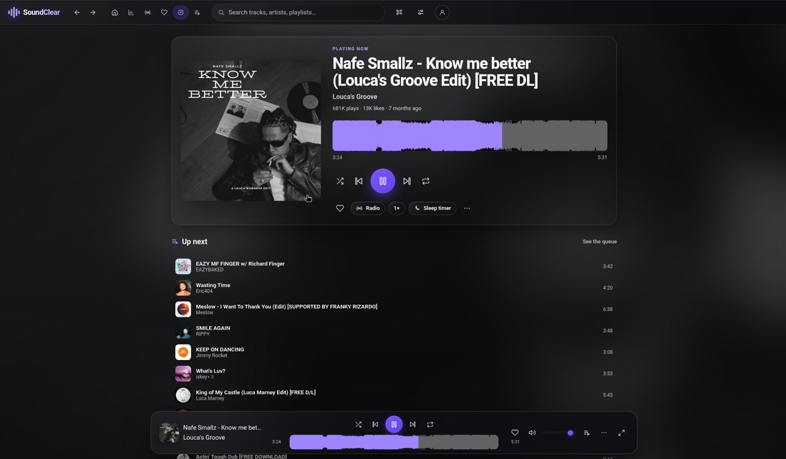
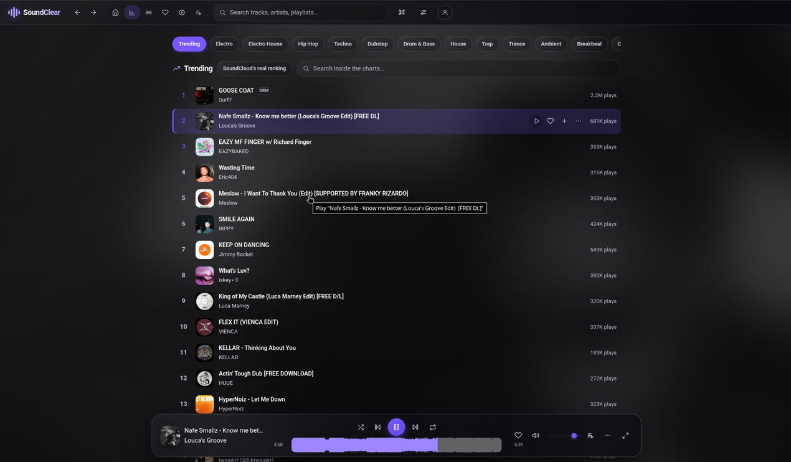

# SoundClear

<p align="center">
  
</p>

> Cliente libre para SoundCloud. Rápido, open source y sin frameworks.
>
> *Proyecto independiente, sin afiliación con SoundCloud.*

SoundClear es un **cliente nativo de SoundCloud** — no es un wrapper de la web. Habla directamente con la API de SoundCloud, renderiza su propia UI, y funciona como **PWA en el navegador** y como **app de escritorio (Tauri)** con el mismo código.

**~80 KB de JavaScript + 17 KB de CSS** (gzip) para la app completa, radio infinita y paleta de comandos incluidas. Sin React, sin Vue, sin Svelte: TypeScript vanilla + CSS. El resto es disciplina.

Un regalo para la comunidad de SoundCloud. MIT, para quien lo quiera, como se hizo siempre.

**[Descargar para macOS](#descargar)** · [Windows y Linux](#descargar) · [Compilar desde el código](#compilar-desde-el-codigo) · [Probar en el navegador](#uso-en-web)





<a id="descargar"></a>

## Descargar

### macOS

La [última release](https://github.com/gaboxdev/soundcloudapp/releases/latest) es la **[v0.1.0](https://github.com/gaboxdev/soundcloudapp/releases/tag/v0.1.0)**. Trae un binario universal (Apple Silicon e Intel), unos 10 MB:

- [SoundClear_0.1.0_universal.dmg](https://github.com/gaboxdev/soundcloudapp/releases/download/v0.1.0/SoundClear_0.1.0_universal.dmg) — ábrelo y arrastra SoundClear a Aplicaciones. Es el que hay que bajar.
- [SoundClear_universal.app.tar.gz](https://github.com/gaboxdev/soundcloudapp/releases/download/v0.1.0/SoundClear_universal.app.tar.gz) — el mismo `.app`, comprimido, por si el DMG no te sirve.

**No está firmado ni notarizado** (la firma de Apple cuesta 99 $/año y este proyecto no cobra nada). macOS lo bloquea la primera vez:

1. Copia SoundClear a Aplicaciones. No lo abras desde el DMG.
2. En Aplicaciones, clic derecho sobre SoundClear › **Abrir** › **Abrir**.
3. Si ese diálogo no sale: **Ajustes del Sistema › Privacidad y seguridad › Abrir igualmente**.

O quita la cuarentena y ábrelo como cualquier otra app:

```bash
xattr -dr com.apple.quarantine /Applications/SoundClear.app
```

Esos dos enlaces son la 0.1.0. Cuando haya otra versión, [la release más reciente](https://github.com/gaboxdev/soundcloudapp/releases/latest) es la que hay que mirar.

### Windows

**La v0.1.0 no incluye instalador de Windows.** Aquella etiqueta solo compiló macOS. En el [workflow actual](./.github/workflows/release.yml), cada etiqueta nueva compila un `.exe` (NSIS) y un `.msi` para Windows x64 y los sube al borrador de la release. Hasta que esa etiqueta exista, [compílalo](#compilar-desde-el-codigo). Compilar en Windows ya está probado — sesión, bandeja, mini reproductor, acrílico nativo y descargas incluidos. Lo que falta es el instalador publicado.

Cuando estén, tampoco irán firmados. SmartScreen avisa la primera vez: **Más información** › **Ejecutar de todas formas**. El instalador NSIS descarga WebView2 si Windows no lo trae (Windows 11 ya lo tiene).

En Windows los atajos globales usan **Ctrl+Alt** en vez de ⌘⌥, y la ventana lleva la barra de título nativa además de la cabecera de la app (en macOS van fundidas).

### Linux

**La v0.1.0 tampoco trae Linux.** El mismo workflow sube un `.deb` y un `.AppImage` (x64) en la próxima etiqueta. Sigue sin estar probado en un escritorio real: trátalo como experimental. En Wayland el cristal de la ventana depende del compositor; con GNOME en X11 o con un compositor antiguo la ventana puede verse opaca.

<a id="compilar-desde-el-codigo"></a>

### Compilar desde el código

Node ≥ 22.18 (recomendado Node 24) y Rust estable:

```bash
git clone https://github.com/gaboxdev/soundcloudapp.git
cd soundcloudapp
npm install
npm run build -w apps/desktop
```

En macOS el `.app` queda en `apps/desktop/src-tauri/target/release/bundle/macos/`; arrástralo a Aplicaciones. Un binario compilado en tu máquina no pasa por la cuarentena de Gatekeeper.

En Windows hacen falta los **Build Tools de Visual Studio** (C++ y el SDK de Windows) y el toolchain de Rust `-msvc`. Salen `nsis/SoundClear_<versión>_x64-setup.exe` y `msi/SoundClear_<versión>_x64_en-US.msi` dentro de `apps/desktop/src-tauri/target/release/bundle/`.

En Linux salen el `.deb` y el `.AppImage` en esa misma carpeta `bundle/`.

Si solo quieres verla funcionando sin compilar nada, `npm run dev` te da la versión web en modo invitado.

---

## ✨ Características

| | |
|---|---|
| 🎧 **Reproductor con waveform** | Scrubber visual interactivo, seek por rangos HTTP, preview de 30s para tracks Go+ (SNIP) |
| 🔑 **Inicio de sesión con SoundCloud** | App de escritorio: entra con tu propia cuenta, ve tu perfil y tus likes sincronizados |
| ✍️ **Escribe en tu cuenta** | Escritorio: seguir artistas, repostear, añadir a tus playlists, crear playlists y **guardar la cola como playlist** |
| 📰 **Tu feed** | Escritorio: lo que publican y repostean los artistas que sigues, con scroll infinito, y un historial que cruza dispositivos |
| 🔎 **Búsqueda en vivo** | Sugerencias mientras escribes, resultados por tracks / playlists / álbumes / usuarios, scroll infinito y filtros por duración, antigüedad, género y licencia (enlazables por URL) |
| 🎚️ **Motor de audio** | Ecualizador de 5 bandas con presets, nivelado suave y **transiciones entre tracks** (encadenado o crossfade de hasta 12 s, con precarga del siguiente) |
| 📥 **Sin conexión** | Guarda tracks en el dispositivo y suenan con la red cortada, con presupuesto de espacio y gestión en Ajustes › Datos; descarga del archivo original cuando el autor la permite (en escritorio, a tu carpeta de música) |
| 🖥️ **Escritorio de verdad** | Atajos globales (⌘⌥Espacio, ⌘⌥←/→, ⌘⌥F), controles en la bandeja, **mini reproductor** siempre encima que no sale en las capturas de pantalla, aviso opcional al cambiar de track y la ventana recuerda dónde estaba |
| ♿ **Accesible de verdad** | Todo alcanzable con teclado (flechas para recorrer listas), foco siempre visible, objetivos de 24 px, anuncio del track para lectores de pantalla y contraste AA en los 7 acentos y los dos temas |
| 🌍 **Español e inglés** | Detecta tu idioma y se cambia en caliente sin recargar; el diccionario inglés solo se descarga si lo usas |
| 🧭 **Explorar** | Radios por género, las etiquetas que de verdad filtran, álbumes destacados y «se parece a lo tuyo» a partir de tu historial |
| 🔗 **Enlaces** | Pega un enlace de SoundCloud en ⌘K y se abre la ficha; compartir con el menú del sistema y esquema `soundclear://` en escritorio |
| 📻 **Radio infinita** | Cuando la cola se acaba sigue sola con la radio de SoundCloud; «Empezar radio» desde cualquier track o artista |
| ⌘ **Paleta de comandos** | `⌘K` para ir a cualquier sitio, cambiar cualquier ajuste o buscar música sin soltar el teclado |
| ▶️ **Ahora suena** | Vista a pantalla completa con carátula grande, onda, velocidad, temporizador y la cola en vivo |
| 📈 **Charts** | Tendencias globales con ranks + 28 géneros para explorar |
| 🏠 **Feed de inicio** | Selecciones curadas de SoundCloud (mixed-selections) |
| 🎵 **Tracks y playlists** | Descripción, comentarios con scroll infinito, tracks relacionados, descargas cuando el autor las permite |
| 👤 **Perfiles** | Populares, tracks, playlists, publicaciones (con reposts), likes y artistas relacionados |
| 📚 **Cola** | Repeat (off/todo/uno), shuffle, persistencia en localStorage |
| ❤️ **Favoritos e historial** | Tus favoritos sincronizados con tu cuenta de SoundCloud; historial local |
| ⚡ **Atajos** | `Espacio` play/pausa · `←/→` ±5 s (`⇧` ±15 s) · `↑/↓` volumen · `N/P` · `M` silenciar · `F` favorito · `X` radio · `A` ahora suena · `/` buscar · `?` ayuda. Soporta Media Session (teclas multimedia del sistema) |
| ⏱️ **Velocidad y temporizador** | 0.75×–2× y «pausar en 15/30/60/120 min» |
| 🌗 **Apariencia** | Oscuro / claro / sistema, seis acentos con contraste verificado más un tono libre a tu gusto, tres niveles de cristal, densidad cómoda o compacta, barra superior fija / al desplazar / oculta |
| 📱 **PWA** | Instalable, service worker con caché de arte y waveforms. Se puede usar entera en modo invitado; la sesión con tu cuenta solo existe en escritorio (ver abajo) |
| 🖥️ **Escritorio** | Tauri 2: binario nativo de pocos MB, sin Electron |
| 🎨 **Skeletons + blur-up** | La UI nunca se siente vacía: carga instantánea, imágenes lazy |

## 🚀 Empezar

```bash
npm install
npm run dev          # web app → http://localhost:5173
npm run dev:desktop  # app de escritorio (requiere Rust)
```

### Uso en web

La API de SoundCloud bloquea CORS desde cualquier origen que no sea `soundcloud.com`. El `client_id` se extrae del propio HTML de SoundCloud (bloque hydratable) y se cachea. Por eso la app web necesita un proxy fino:

- **Dev**: ya incluido en Vite (`apps/web/vite.config.ts`) — `/sl-proxy` y `/sl-client-id`.
- **Producción**: despliega el Cloudflare Worker en `proxy/worker` (~100 líneas) y pon su URL en **Ajustes → Proxy (avanzado)**. Funciona gratis en el plan free de Cloudflare.

El audio y los waveforms se sirven directo desde los CDNs de SoundCloud (`Access-Control-Allow-Origin: *`), sin pasar por el proxy.

> **Qué puedes hacer en el navegador**: la app funciona entera en **modo invitado** — buscar, explorar, escuchar, cola, radio, favoritos e historial guardados en ese navegador. Al abrir verás la pantalla de acceso con el botón **«Explorar sin cuenta»**; a partir de ahí no falta nada de la experiencia local.
>
> Lo que **solo** existe en la app de escritorio es la sesión con tu cuenta de SoundCloud (cookies de terceros + CORS lo impiden en el navegador) y todo lo que depende de ella: tu perfil, tus likes sincronizados, el feed, seguir, repostear y escribir en tus playlists.

### Cuenta e inicio de sesión (escritorio)

Al abrir la app, **lo primero que verás es la pantalla de inicio de sesión**. Conectar tu cuenta es lo recomendable —así tus likes viajan contigo— pero no es obligatorio: **«Explorar sin cuenta»** entra directo en modo invitado, con los favoritos guardados solo en ese dispositivo. 

SoundCloud cerró el registro de apps OAuth para nuevos desarrolladores, así que SoundClear se conecta con el **login nativo de SoundCloud**: la app abre una ventana con `soundcloud.com`, inicias sesión ahí (con tu cuenta, 2FA incluido) y la sesión queda guardada en la webview. Las peticiones autenticadas (`/me`, tus likes, quitar like) se hacen desde un webview oculto en el mismo origen que la API, donde el CORS de SoundCloud sí permite `soundcloud.com`.

Disponible en **Ajustes → Cuenta** y en **Favoritos → Tu cuenta**:

- Tu perfil (avatar, nombre, seguidores)
- Tus likes de SoundCloud, con play en cola y quitar like
- Cerrar sesión (desde la ventana de sesión)

**Sobre passkeys y botones sociales (Google/Apple)**: la webview del sistema en macOS no soporta passkeys (WebAuthn de plataforma) — es una limitación de WebKit, [issue abierta en Tauri](https://github.com/tauri-apps/tauri/issues/7926) desde 2023. Si al iniciar sesión con Google o Apple te pide passkey, elige **«Usar contraseña» / «Otras opciones»**: el login con email + contraseña (+ código 2FA) funciona perfectamente en la app. La ventana de login muestra un aviso automático en esas pantallas. En Windows (WebView2/Chromium) los passkeys sí funcionarán.

La versión de navegador no puede guardar la sesión (cookies de terceros + CORS): ahí la pantalla de acceso te ofrece el modo invitado y te indica cómo conseguir la app de escritorio.

## 🏗️ Arquitectura

```
packages/soundcloud-api   # Cliente tipado de la API v2 de SoundCloud (transport pluggable)
apps/web                  # SPA: Vite + TypeScript vanilla (0 frameworks)
apps/desktop              # Tauri 2 (Rust): comandos proxy_fetch y get_client_id
proxy/worker              # Cloudflare Worker para el build web en producción
.github                   # CI + plantillas de issues/PRs
```

- **Transport pluggable**: `ProxyTransport` (web) o `TauriTransport` (escritorio) — un solo `SoundCloudAPI` para ambos.
- **Micro-store pub/sub**: `createStore` (~20 líneas) alimenta al reproductor, la cola y las vistas.
- **Router hash-based**: vistas auto-registradas, sin dependencias.
- El bundle de `hls.js` (solo para tracks sin MP3 progresivo) se carga *lazy*.

Detalles técnicos en [AGENTS.md](./AGENTS.md).

## 🧠 Detalles que importan

- `artwork_url` es `null` ~34% de las veces → fallback con iniciales siempre.
- `policy: 'SNIP'` = preview de 30s (exclusivo Go+). `duration` viene clamped.
- Los comentarios necesitan `threaded=1`.
- El `next_href` de la API no trae client_id — el transport lo inyecta y reescribe.
- Si SoundCloud rota el client_id, la app se re-autentica sola (retry con cache reset).

## 🗺️ Roadmap

- [x] Cuenta y sincronización de likes (resuelto con el login nativo en la webview, sin OAuth)
- [x] Modo invitado en la versión web («Explorar sin cuenta», favoritos locales)
- [x] Estaciones de radio de tracks y artistas
- [ ] Más tamaños de arte (CDN) y opción de calidad
- [ ] Versión móvil nativa
- [x] Flujo de compilados para macOS y Windows (macOS publicado en v0.1.0; Windows en la próxima etiqueta)
- [~] Compilados de Linux en el workflow de release, sin validar todavía en un escritorio real
- [x] Soporte de idiomas (español e inglés, cambio en caliente)

¿Ideas? Abre un issue o un PR — este proyecto es tuyo también.

## 🤝 Contribuir

1. Fork + rama (`feat/nombre`)
2. `npm run typecheck`, `npm test` y `npm run build` en verde
3. PR con descripción clara — mira el [template](./.github/pull_request_template.md)

Normas: sin comentarios en el código, UI en español, TS estricto, clases kebab-case, nada de frameworks. Todo el detalle —convenciones, cómo añadir una vista, qué no se acepta— en [CONTRIBUTING.md](./CONTRIBUTING.md).

Antes de abrir el primer issue, el [código de conducta](./CODE_OF_CONDUCT.md) cabe en dos minutos.

¿Encontraste un fallo de seguridad? No abras un issue: [SECURITY.md](./SECURITY.md) explica cómo reportarlo en privado.

## ⚖️ Legal

**SoundClear es un proyecto independiente de código abierto, sin afiliación, patrocinio ni respaldo de SoundCloud.** No está desarrollado, avalado ni revisado por SoundCloud.

### Alcance técnico

SoundClear habla con endpoints de SoundCloud que **no forman parte de una API pública documentada**: el identificador de cliente se extrae en tiempo de ejecución del HTML del propio sitio y las llamadas viajan por un proxy propio. La consecuencia práctica es que **la app puede dejar de funcionar sin aviso** si SoundCloud cambia sus endpoints, sus cabeceras o sus CDN.

No es un defecto del proyecto: es el precio de que no exista app oficial. No hay una API pública a la que pidiendo permiso se le pueda migrar.

SoundCloud mantiene sus condiciones de uso sobre su API, y este proyecto las respeta en su letra donde puede: **no reproduce medios cifrados con DRM**, no redistribuye ni rehospeda audio, y solo descarga archivos cuando el artista lo permite. Si SoundCloud pide que el proyecto deje de operar contra su servicio, se para.

«SoundCloud» es una marca registrada de SoundCloud Global Limited & Co. KG. Sus marcas, logotipos y contenido pertenecen a sus respectivos dueños y aquí se mencionan únicamente de forma descriptiva, para indicar con qué servicio funciona este cliente. SoundClear no usa el nombre ni el logotipo de SoundCloud como identidad propia: tiene su propio nombre y su propia marca.

SoundClear consulta endpoints de SoundCloud, incluidos los de tu cuenta cuando inicias sesión. El audio se reproduce desde sus servidores; la opción sin conexión guarda audio reproducible en el dispositivo y la descarga de archivos usa el permiso `downloadable` del track. La app no reproduce medios cifrados con DRM. Licencia [MIT](./LICENSE).

---

Hecho con ❤️ para la comunidad. *"El primero de muchos."*
